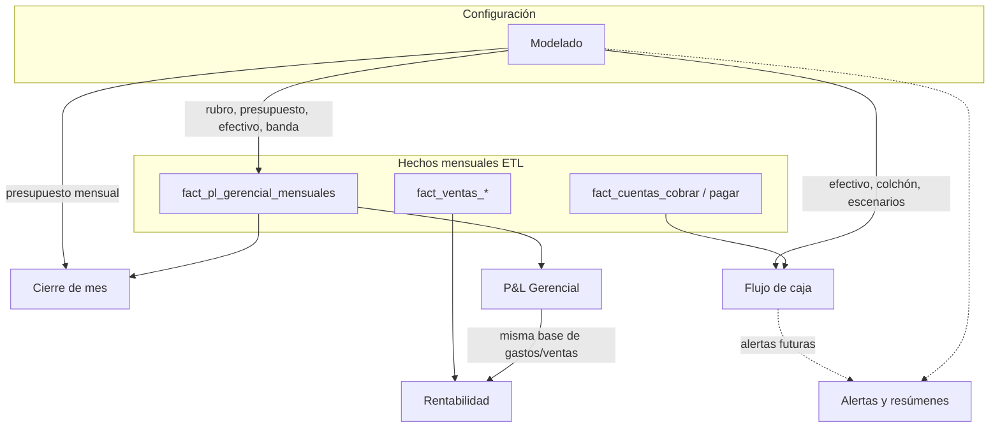

# Análisis — Dashboard Suite Financiera

Documento de **propósito y responsabilidades** de cada pestaña del dashboard **Finanzas** (`Frontend/src/app/views/dashboard/sections/finanzas/`). Complementa los análisis de datos por sección en esta misma carpeta.

**Audiencia:** producto, diseño y desarrollo. Responde: *¿para qué sirve cada parte y qué no debe hacer?*

---

## 1. Qué es la Suite Financiera

Es el tab **Finanzas** del dashboard principal (`app-finanzas`). Agrupa la **gestión gerencial del negocio** en seis vistas: resultado del periodo, márgenes por dimensión, liquidez a corto plazo, cierre mensual, configuración del modelo y (futuro) alertas.

No reemplaza:

- **Contabilidad formal** (libros, partidas, cierre contable en `contabilidad/cierre-mes`).
- **Reportes financieros clásicos** del menú Finanzas (antigüedad, reportes resumen, etc.).
- **Operación diaria** (ventas, compras, caja POS).

Sí conecta con ellos: lee hechos del warehouse (`smartpyme_analitica`) y configuración de producción (`modelado_*` vía Laravel).

### Stack resumido

| Capa | Rol |
|------|-----|
| **Angular** | UI, filtros compartidos, servicios `finanzas-*-data.service.ts` |
| **sp-analytics (Go)** | Lectura agregada: P&L, rentabilidad, flujo, cierre, modelado (expediente) |
| **Laravel** | Escritura de modelado (JWT, empresa del token) |
| **ETL Go** | Llena `fact_*` desde producción; P&L ya puede usar `modelado_clasificaciones` |

---

## 2. Cómo se relacionan las pestañas

**Idea central:** **Modelado** no es un informe; es el **centro de configuración**. **P&L** y **Rentabilidad** responden *¿cómo fue el periodo?* **Flujo** responde *¿alcanza el efectivo en las próximas semanas?* **Cierre** responde *¿puedo certificar este mes gerencialmente?* **Alertas** (pendiente) avisará cuando algo de lo anterior se salga de lo esperado.

---

## 3. Filtros del encabezado

| Filtro | Pestañas | Efecto |
|--------|----------|--------|
| Mes + año | P&L, Rentabilidad | Mes de corte compartido; se conserva al cambiar de tab |
| Sucursal | P&L, Rentabilidad, Flujo | Consolidado o una sucursal |
| Horizonte (mes / trimestre / año) | Rentabilidad (toolbar visible siempre) | Ventana de agregación sobre el mes de corte |
| Periodo mes / año completo | Solo P&L | Columna principal e YTD |
| Base gerencial / caja | Solo P&L | Sin IVA vs con IVA |
| Comparación | Solo P&L | vs mes anterior, -2 meses o presupuesto |

**Cierre de mes** usa el año calendario actual y el mes activo de la barra (no comparte mes/año del toolbar). **Modelado** usa el año en curso para presupuesto. **Flujo** proyecta **12 semanas desde hoy**; el mes del toolbar no entra al API de flujo (solo sucursal).

Detalle de cableado: `suite-financiera-frontend.md`.

---

## 4. Qué debe hacer cada sección

### 4.1 P&L Gerencial

**Pregunta del usuario:** *¿Cuánto vendimos, cuánto costó y cuánto nos quedó en este mes (o en el año hasta este mes), comparado con el mes pasado o el presupuesto?*

| Debe hacer | No debe hacer |
|------------|----------------|
| Mostrar KPIs ejecutivos (ventas netas, utilidades, márgenes) | Listar facturas o asientos |
| Tabla de estado de resultados con % sobre ventas, variación y acumulado | Editar categorías contables |
| Bloque «gastos como % de ventas» con tendencia 6 meses | Presupuestar (eso es Modelado) |
| Respetar sucursal y base sin IVA / con IVA | Mezclar sucursales sin aviso |

**Backend:** `GET /api/finanzas/pl-gerencial` → `fact_pl_gerencial_mensuales` (+ comparación y presupuesto según query).

**Depende de Modelado:** rubro de gasto en el ETL del P&L; presupuesto en columna «vs presupuesto» cuando exista anual partido.

**Doc detallado:** [pl-gerencial-datos.md](./pl-gerencial-datos.md)

---

### 4.2 Rentabilidad

**Pregunta del usuario:** *¿Dónde gano o pierdo dinero: sucursal, producto, cliente, proveedor u obra?*

| Debe hacer | No debe hacer |
|------------|----------------|
| Cinco dimensiones con tabla + detalle al hacer clic | Sustituir al P&L consolidado |
| KPIs dinámicos según la fila seleccionada | Repartir gastos fijos de sucursal sobre cada producto (el margen producto es costo de lo vendido) |
| Horizonte mes, trimestre o año sobre el mismo corte | Inventar «última compra» o series si el hecho no existe |

**Backend:** `GET /api/finanzas/rentabilidad` → agregados sobre ventas, gastos, compras, proyectos, etc.

**Depende de Modelado:** poco en v1; el costo de capital del modelado no alimenta aún el KPI «costo de esperar el cobro».

**Doc detallado:** [rentabilidad-datos.md](./rentabilidad-datos.md)

---

### 4.3 Flujo de caja

**Pregunta del usuario:** *¿Me quedo sin efectivo en las próximas semanas? ¿A quién cobro y qué pago primero?*

| Debe hacer | No debe hacer |
|------------|----------------|
| Posición: CXC por antigüedad, CXP por vencimiento, salidas con fecha | Mostrar proyección sin efectivo inicial configurado (posición sí, gráfico vacío) |
| Proyección 12 semanas con sliders de cobro y meta de ventas | Prorratear egresos mensuales del P&L como si fueran semana a semana sin reglas |
| KPIs: semana crítica, vs colchón, cobro/meta necesarios | Duplicar el calendario completo de Modelado (usa reglas + parámetros) |

**Backend:** `GET /api/finanzas/flujo-caja` → CXC/CXP mensuales, parámetros, motor `Walk` en el request.

**Depende de Modelado:** efectivo, colchón y banda conservador/optimista (`modelado_pronosticos`); si no hay fila, fallback a `flujo_caja_parametros` y −10 / +12.

**Doc detallado:** [flujo-caja-datos.md](./flujo-caja-datos.md)

---

### 4.4 Cierre de mes (gerencial)

**Pregunta del usuario:** *¿Este mes está listo para declararlo cerrado a nivel gerencial? ¿Qué se salió del presupuesto o del rango habitual?*

| Debe hacer | No debe hacer |
|------------|----------------|
| Barra de 12 meses: cerrado / activo / pendiente; cerrar en orden | Generar asiento de cierre contable |
| Comparar real vs presupuesto en las **siete líneas** del P&L | Certificar si el checklist tiene pendientes (cuando exista checklist) |
| Marcar gastos fuera de rango vs promedio 6 meses | Inventar impuestos (IVA F-07 / pago a cuenta F-14 vienen del módulo contador) |

**Backend:** `GET /api/finanzas/cierre-mes` → P&L consolidado, certificaciones, descartes de fuera-de-rango.

**Estado actual:** presupuesto por rubro desde Modelado cuando hay anual; checklist e impuestos vacíos; **Certificar** / **Es normal** sin POST todavía.

**Depende de Modelado:** presupuesto mensual por línea; en el futuro checklist ligado al calendario de salidas.

**Doc detallado:** [cierre-mes-datos.md](./cierre-mes-datos.md)

**No confundir con:** `Frontend/.../contabilidad/cierre-mes` (balance y partidas).

---

### 4.5 Modelado

**Pregunta del usuario:** *¿Cómo clasifico gastos, cuándo salen del banco, cuál es mi presupuesto del año y con qué supuestos proyecto la caja?*

| Debe hacer | No debe hacer |
|------------|----------------|
| Paso 1: fijo/variable y rubro por tipo de gasto | Guardar montos mensuales duplicando el real |
| Paso 2: calendario de costos fijos (manual) | Editar planillas/préstamos desde aquí (solo lectura cuando existan) |
| Paso 3: presupuesto anual 7 líneas + reparto igual/estacional | Presupuesto por sucursal o área (fuera de alcance v1) |
| Paso 4: efectivo, colchón, costo capital, banda de escenarios | Calcular y persistir punto de equilibrio o % configurado |
| Mostrar % «configurado» y equilibrio **calculados** | Copiar el P&L real como si fuera presupuesto |

**Escritura:** Laravel (`PUT/POST/DELETE` bajo JWT). **Lectura de pantalla:** Go `GET /api/finanzas/modelado`.

**Doc detallado:** [modelado-datos.md](./modelado-datos.md)

---

### 4.6 Alertas y resúmenes

**Pregunta del usuario:** *¿Qué me avisan por WhatsApp o correo cuando algo va mal (caja, cobros, cierre)?*

| Debe hacer (diseño) | Estado hoy |
|---------------------|------------|
| Catálogo de alertas activables (colchón, efectivo desactualizado, facturas vencidas, etc.) | UI con mocks (`alertas-*.mock.ts`) |
| Resúmenes periódicos semanal/mensual por canal | Sin backend |
| Vista previa de mensajes | Estático en mock |

**Depende de:** Flujo (proyección y colchón), Modelado (antigüedad del efectivo), Cierre, CXC. No hay API aún.

**Referencia UI:** `alertas-resumenes/`, catálogo en `alertas-catalogo.mock.ts`.

---

## 5. Matriz rápida

| Pestaña | Tipo | Lee | Escribe | Pregunta clave |
|---------|------|-----|---------|----------------|
| P&L Gerencial | Informe | Warehouse | — | ¿Resultado del periodo? |
| Rentabilidad | Informe | Warehouse | — | ¿Margen por dimensión? |
| Flujo de caja | Informe + simulación | Warehouse + params | — (efectivo en Modelado) | ¿Liquidez 12 semanas? |
| Cierre de mes | Proceso gerencial | Warehouse + certs | Certificar (pendiente) | ¿Mes cerrado y sano? |
| Modelado | Configuración | Real + guardado | Laravel | ¿Supuestos del resto? |
| Alertas | Notificaciones | (futuro) | Preferencias (futuro) | ¿Qué me avisan? |

---

## 6. Orden sugerido de uso (negocio)

1. **Modelado** — Clasificar gastos, calendario, presupuesto y efectivo (una vez y mantener).
2. **P&L / Rentabilidad** — Revisar desempeño del mes o trimestre con filtros compartidos.
3. **Flujo de caja** — Validar que la caja aguanta con la posición actual y supuestos.
4. **Cierre de mes** — Certificar el mes cuando presupuesto y anomalías estén revisados.
5. **Alertas** — Dejar suscritos los avisos para no entrar todos los días (cuando exista backend).

---

## 7. Documentos por sección

| Sección | Análisis de datos |
|---------|-------------------|
| P&L Gerencial | [pl-gerencial-datos.md](./pl-gerencial-datos.md) |
| Rentabilidad | [rentabilidad-datos.md](./rentabilidad-datos.md) |
| Flujo de caja | [flujo-caja-datos.md](./flujo-caja-datos.md) |
| Cierre de mes | [cierre-mes-datos.md](./cierre-mes-datos.md) |
| Modelado | [modelado-datos.md](./modelado-datos.md) |
| Frontend / mocks | [suite-financiera-frontend.md](./suite-financiera-frontend.md) |

---

## 8. Brechas conocidas (oct 2026)

- **Alertas:** solo diseño; sin motor ni envío.
- **Cierre:** certificación, checklist completo, impuestos desde contador, POST «es normal».
- **Modelado:** planillas/préstamos, sucursal/área en presupuesto, días reales de cobro/pago.
- **Flujo:** persistencia de efectivo desde la pestaña (hoy vía Modelado); vista «Mensual» sin serie.
- **Rentabilidad doc:** el párrafo «frontend en mock» en `rentabilidad-datos.md` está desactualizado; la pestaña ya usa API (ver `suite-financiera-frontend.md`).

Actualizar este documento cuando cambie el alcance de una pestaña o se cierre una brecha.
